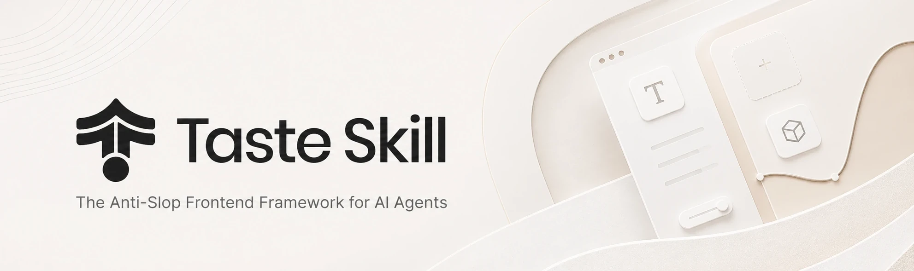
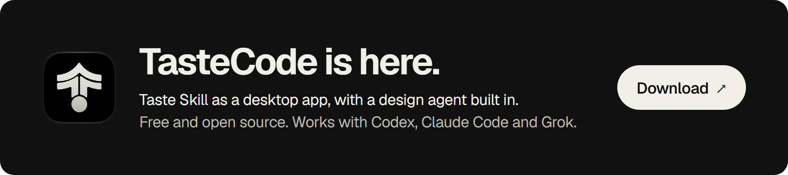
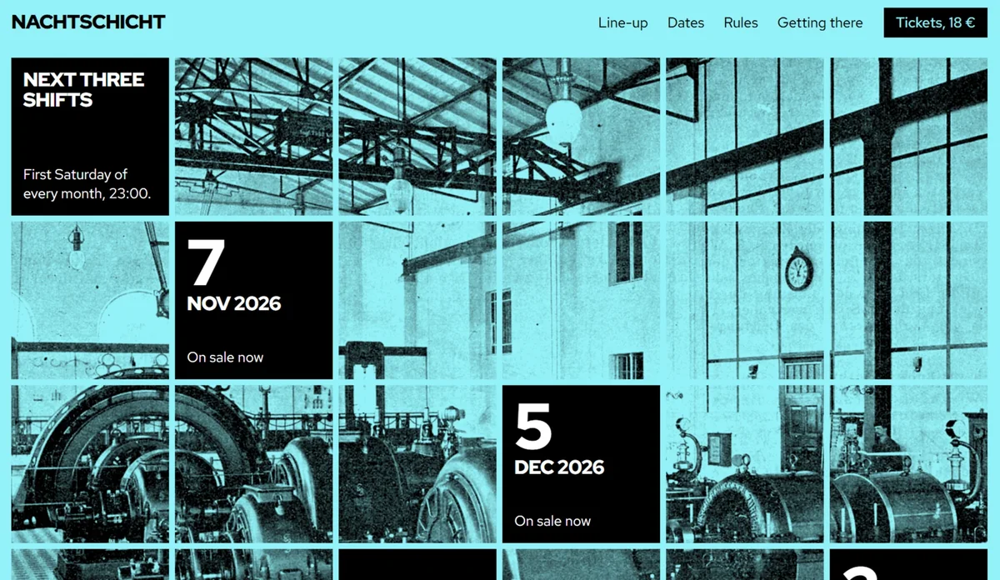
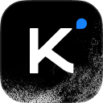

<p align="center">
  
</p>

<p align="center">
  <a href="https://taste.ndjp.net"></a>
  &nbsp;
  <a href="https://tasteskill.dev"></a>
  &nbsp;
  <a href="https://tastecode.dev"></a>
  &nbsp;
  <a href="LICENSE"></a>
  &nbsp;
  <a href="https://github.com/vercel-labs/agent-skills"></a>
  &nbsp;
  <a href="https://github.com/Leonxlnx/taste-skill/blob/main/CHANGELOG.md"></a>
</p>

<p align="center">
  <a href="https://tastecode.dev"></a>
</p>

<p align="center"><sub>想最省事地拿到 Taste Skill 的效果：<a href="https://tastecode.dev"><strong>下载 TasteCode</strong></a>。它的设计 Agent 会先跟你对齐需求，再动手构建，然后用眼睛复查界面。<a href="https://github.com/Leonxlnx/tastecode">源码在 GitHub</a>。</sub></p>

<h3 align="center">赞助者</h3>

<table align="center">
  <tr>
    <td align="center" width="104"><a href="https://fluxionai.space/register?source=github&amp;campaign=github-tasteskill&amp;promo=TASTESKILL"></a></td>
    <td><sub><a href="https://fluxionai.space/register?source=github&amp;campaign=github-tasteskill&amp;promo=TASTESKILL"><strong>Sidrune AI</strong></a>：一个 API 接入 GPT、Claude 等主流模型。<br />通过这个链接注册可获 3 美元 API 额度。</sub></td>
  </tr>
  <tr>
    <td align="center" width="104">
      <a href="https://interfaces.dev/?utm_source=tasteskill&amp;utm_medium=sponsorship">
        
      </a>
    </td>
    <td><sub><a href="https://interfaces.dev/?utm_source=tasteskill&amp;utm_medium=sponsorship"><strong>interfaces.dev</strong></a> · 设计工程杂志，由 <a href="https://github.com/jakubkrehel"><strong>Jakub Krehel</strong></a> 主理</sub></td>
  </tr>
  <tr>
    <td align="center" width="104">
      <a href="https://reactbits.dev">
        <picture>
          <source media="(prefers-color-scheme: dark)" srcset="public/images/sponsors/reactbits-icon-dark.svg" />
          
        </picture>
      </a>
    </td>
    <td><sub><a href="https://reactbits.dev"><strong>React Bits</strong></a> · 面向创意界面的动画 React 组件库</sub></td>
  </tr>
  <tr>
    <td align="center" width="104"><a href="https://img.ly/"></a></td>
    <td><sub><a href="https://img.ly/"><strong>IMG.LY</strong></a> · CreativeEditor SDK</sub></td>
  </tr>
  <tr>
    <td align="center" width="104"><a href="https://www.sent.dm"></a></td>
    <td><sub><a href="https://www.sent.dm"><strong>Sent.dm</strong></a> · SMS、WhatsApp 与 RCS 的消息 API</sub></td>
  </tr>
</table>

<p align="center"><sub><a href="https://github.com/sponsors/Leonxlnx">成为赞助者</a></sub></p>

**Taste Skill（品味技能）** 是一组 Agent 技能，它让编码 Agent 去「做设计」，而不是拼出那个平均值的落地页。默认技能给 Agent 一套艺术指导、真实图片，以及一个在真实浏览器里检查自己作品的办法。

它建出来的页面，每一个都来自一份简短需求：

<table>
  <tr>
    <td width="50%"></td>
    <td width="50%"></td>
  </tr>
  <tr>
    <td width="50%"></td>
    <td width="50%"></td>
  </tr>
</table>

这些照片都是真实的，从开放档案里找出来，并由技能逐一署名（[署名清单](https://github.com/Leonxlnx/taste-skill/blob/main/examples/v2/CREDITS.md)）。可以看看[发布影片](https://github.com/Leonxlnx/taste-skill/releases/tag/v2.0.0)。

<p align="center"><sub><a href="#安装">安装</a> · <a href="#v2-是怎么工作的">工作原理</a> · <a href="#技能">技能</a> · <a href="#常见问题">常见问题</a> · <a href="#支持本项目">赞助</a> · <a href="#本站">关于本站</a> · <a href="#许可证">许可证</a></sub></p>

## 安装

```bash
npx skills add https://github.com/Leonxlnx/taste-skill
```

这条命令会用 [`npx skills`](https://github.com/vercel-labs/agent-skills) CLI 装上仓库里的每一个技能。只装一个的话，传入它的**安装名**：

```bash
npx skills add https://github.com/Leonxlnx/taste-skill --skill "design-taste-frontend"
```

默认技能用 **Node 22+** 运行它的脚本，并且需要一个已安装的 **Chrome、Edge 或 Chromium**。它不安装任何东西，也不需要 API Key；只有找图片时需要联网。

<details>
<summary>Claude Code 插件</summary>

在 Claude Code 里运行。每个技能都带 `taste-skill:` 前缀，所以不会和你已有的技能撞名。

```
/plugin marketplace add Leonxlnx/taste-skill
/plugin install taste-skill@taste-skill
```

以后用 `/plugin update` 升级。

</details>

<details>
<summary>Codex 插件</summary>

```bash
codex plugin marketplace add Leonxlnx/taste-skill
codex plugin add taste-skill@taste-skill
```

装完之后新开一个 Codex 会话，技能才会被加载。

</details>

<details>
<summary>从克隆安装：链接而不是复制</summary>

`./install.sh` 会把技能软链到 Claude Code 的技能目录（`--codex` 指向 Codex，`--all-agents` 两个都指），这样一次 `git pull` 就能原地更新它们。`./install.sh --list` 会列出所有安装名。

</details>

已经装过了？重新运行一遍安装命令即可。安装名没有变过，旧版本也仍然以各自的安装名保留着（见[技能](#技能)）。

## v2 是怎么工作的

默认技能出自一项对 247 个精选站点的研究。一次构建走六个步骤：

1. 读取需求，列出只有这个客户才有的东西。
2. 脚本从 20 个研究过的方向里发出三张牌，Agent 选一张。
3. 立论：用一句话把客户自己的素材和那个方向的手法系在一起。
4. 用开放馆藏里的真实图片与影像构建页面，并逐一署名。
5. 在三个宽度下的真实浏览器里检查页面，发现套路就判失败。
6. 看自己的截图，修掉最差的三处问题，最多三轮。

一次构建大约需要 30 到 45 分钟、几十万 tokens。细节见[更新日志](https://github.com/Leonxlnx/taste-skill/blob/main/CHANGELOG.md)与[研究文档](https://github.com/Leonxlnx/taste-skill/blob/main/skills/taste-skill/references/research.md)。

## 技能

每个技能只做一件事，你不必全都装。**安装名**就是传给 `--skill` 的那个值。

| 技能 | 安装名 | 说明 |
| --- | --- | --- |
| **[taste-skill](https://github.com/Leonxlnx/taste-skill/blob/main/skills/taste-skill/SKILL.md)** | `design-taste-frontend` | v2。面向落地页、营销官网、作品集与产品页的艺术指导，任何技术栈都可用。工作方式如上。 |

<details>
<summary>针对特定任务的技能（8 个）</summary>

| 技能 | 安装名 | 说明 |
| --- | --- | --- |
| **[redesign-skill](https://github.com/Leonxlnx/taste-skill/blob/main/skills/redesign-skill/SKILL.md)** | `redesign-existing-projects` | 已有项目：先审计界面，再修布局、留白、层级与样式。 |
| **[image-to-code-skill](https://github.com/Leonxlnx/taste-skill/blob/main/skills/image-to-code-skill/SKILL.md)** | `image-to-code` | 先生成网站参考图，分析它们，再实现与之匹配的前端。 |
| **[gpt-tasteskill](https://github.com/Leonxlnx/taste-skill/blob/main/skills/gpt-tasteskill/SKILL.md)** | `gpt-taste` | 面向 GPT 与 Codex 的更严格变体：更高的布局差异度、更强的动效方向感。 |
| **[soft-skill](https://github.com/Leonxlnx/taste-skill/blob/main/skills/soft-skill/SKILL.md)** | `high-end-visual-design` | 冷静、精致的界面：柔和对比、充足留白、弹性动效。 |
| **[minimalist-skill](https://github.com/Leonxlnx/taste-skill/blob/main/skills/minimalist-skill/SKILL.md)** | `minimalist-ui` | 编辑型产品界面，克制的配色，清晰的结构。 |
| **[brutalist-skill](https://github.com/Leonxlnx/taste-skill/blob/main/skills/brutalist-skill/SKILL.md)** | `industrial-brutalist-ui` | 强硬的机械感语言：瑞士字体、锐利的尺度对比、实验性布局。 |
| **[stitch-skill](https://github.com/Leonxlnx/taste-skill/blob/main/skills/stitch-skill/SKILL.md)** | `stitch-design-taste` | 为 Google Stitch 准备的规则，可导出 `DESIGN.md`。 |
| **[output-skill](https://github.com/Leonxlnx/taste-skill/blob/main/skills/output-skill/SKILL.md)** | `full-output-enforcement` | 应对模型交半成品：完整输出，禁止占位注释。 |

</details>

<details>
<summary>图像生成类技能（3 个）</summary>

这些技能只产出设计图，不写代码。配合 ChatGPT Images、Codex 图像模式，或任何能生图的 Agent 使用，然后把画面交给你的编码 Agent。

| 技能 | 安装名 | 说明 |
| --- | --- | --- |
| **[imagegen-frontend-web](https://github.com/Leonxlnx/taste-skill/blob/main/skills/imagegen-frontend-web/SKILL.md)** | `imagegen-frontend-web` | 网站构图：首屏、落地页、多区块页面。 |
| **[imagegen-frontend-mobile](https://github.com/Leonxlnx/taste-skill/blob/main/skills/imagegen-frontend-mobile/SKILL.md)** | `imagegen-frontend-mobile` | iOS、Android 与跨平台的移动端屏幕与流程。 |
| **[brandkit](https://github.com/Leonxlnx/taste-skill/blob/main/skills/brandkit/SKILL.md)** | `brandkit` | 品牌套件板：Logo 方向、配色、字体、应用。 |

</details>

### 我该用哪个？

- 要做新的公开页面：**taste-skill**。
- 要改一个已经存在的页面：**redesign-skill**。
- 视觉方向已经定了：**soft-skill**、**minimalist-skill** 或 **brutalist-skill**。
- 想先要图、再要代码：用某个图像生成技能，或者用 **image-to-code-skill** 一条链路走完。
- Agent 总是把输出砍短：加上 **output-skill**。

<details>
<summary>taste-skill 的旧版本</summary>

为依赖它们确切行为的项目保留。

| 技能 | 安装名 | 说明 |
| --- | --- | --- |
| **[taste-skill-v2-experimental](https://github.com/Leonxlnx/taste-skill/blob/main/skills/taste-skill-v2-experimental/SKILL.md)** | `design-taste-frontend-v2-experimental` | 单文件、三旋钮驱动的重写版，是 v2 成为默认之前的默认技能。 |
| **[taste-skill-v1](https://github.com/Leonxlnx/taste-skill/blob/main/skills/taste-skill-v1/SKILL.md)** | `design-taste-frontend-v1` | 最初的版本。 |

```bash
npx skills add https://github.com/Leonxlnx/taste-skill --skill "design-taste-frontend-v2-experimental"
npx skills add https://github.com/Leonxlnx/taste-skill --skill "design-taste-frontend-v1"
```

这两个版本的文件顶部都有三个 1 到 10 的旋钮：**DESIGN_VARIANCE**（居中规整 → 非对称）、**MOTION_INTENSITY**（只有悬停 → 滚动驱动）、**VISUAL_DENSITY**（宽敞 → 密集）。v2 没有旋钮：它的方向来自抽牌，它的边界来自检查器。

</details>

## 常见问题

**默认技能需要什么？**
Node 22 或更高版本，以及 Chrome、Edge 或 Chromium。它不安装任何东西，也不用 API Key；只有找图片时需要联网。

**图片从哪里来，我能用吗？**
来自 Wikimedia Commons、Openverse、大都会艺术博物馆这类开放馆藏。技能只提供公共领域、CC0、CC BY 与 CC BY-SA 的文件，并把署名放在页面上。你有自己的照片时直接替换掉它们。

**支持 React、Vue、Svelte、纯 HTML 吗？**
支持。这些规则约束的是设计，不是某个框架。

**它是给仪表盘和应用界面用的吗？**
不是。默认技能面向对外的公开页面。产品界面请用 **minimalist-skill** 或 **soft-skill**。

**跑一次要多久、贵不贵？**
约 30 到 45 分钟、几十万 tokens。开销的大头在最后「回看」这一步：项目没有自己的照片时，找图与画图会占掉大部分时间。

## 支持本项目

如果 Taste Skill 对你有帮助，欢迎赞助：

[在 GitHub 上赞助](https://github.com/sponsors/Leonxlnx)

### 开源支持者

<table align="center">
  <tr>
    <td align="center" width="104"><a href="https://www.kimi.com"></a></td>
    <td><a href="https://platform.kimi.ai?track_id=track-20f0d64bcaba419bb425a3e8c306f65d&amp;aff=taste-skill"><strong>获取 Kimi API Key</strong></a>：taste-skill 用户首次购买可额外获得 10% API 额度。</td>
  </tr>
  <tr>
    <td align="center" width="104"><a href="https://vercel.com/open-source-program"></a></td>
    <td><a href="https://vercel.com/open-source-program">Vercel Open Source Program 提供支持。</a></td>
  </tr>
</table>

<details>
<summary>社区赞助者</summary>

<a href="https://github.com/dnakov"></a>
<a href="https://github.com/AkramReshad"></a>
<a href="https://github.com/ajmalaksar25"></a>
<a href="https://github.com/krikkkk"></a>
<a href="https://github.com/navanchauhan"></a>
<a href="https://github.com/robinebers"></a>
<a href="https://github.com/JKc66"></a>
<a href="https://github.com/u2393696078-rgb"></a>
<a href="https://github.com/a-human-created-this"></a>
<a href="https://github.com/AtharvaJaiswal005"></a>
<a href="https://github.com/ghughes7"></a>
<a href="https://github.com/mccun934"></a>
<a href="https://github.com/techmedic5"></a>
<a href="https://github.com/bytewerk-dev"></a>
<a href="https://github.com/LuisGot"></a>
<a href="https://github.com/oskar-collab"></a>
<a href="https://github.com/denvit"></a>
<a href="https://github.com/onedollarstock"></a>
<a href="https://github.com/KANA-33"></a>
<a href="https://github.com/emilkowalski"></a>
<a href="https://github.com/AnthonyLiuVa"></a>
<a href="https://github.com/Wolfy18"></a>
<a href="https://github.com/Gigslol"></a>

<p align="center">
 <a href="https://www.star-history.com/leonxlnx/taste-skill">
  <picture>
   <source media="(prefers-color-scheme: dark)" srcset="https://api.star-history.com/badge?repo=Leonxlnx/taste-skill&theme=dark" />
   <source media="(prefers-color-scheme: light)" srcset="https://api.star-history.com/badge?repo=Leonxlnx/taste-skill" />
   
  </picture>
 </a>
</p>

</details>

<p align="center"><sub>反馈请开 Issue 或 PR，或私信 <a href="https://x.com/lexnlin">@lexnlin</a> / <a href="https://x.com/blueemi99">@blueemi99</a>，也可发邮件至 <a href="mailto:hello@tasteskill.dev">hello@tasteskill.dev</a>。</sub></p>

<p align="center"><sub>Taste Skill 没有官方发行的代币、硬币或加密项目。任何使用作者姓名、形象或本项目名义的代币都与作者无关，也未获得认可。</sub></p>

## 研究

塑造这些技能的背景研究位于 [`research/`](https://github.com/Leonxlnx/taste-skill/tree/main/research)，其中 [LLM 输出截断研究](https://github.com/Leonxlnx/taste-skill/tree/main/research/laziness) 解释了模型为什么会交半成品，以及如何补救。

## 本站

这个仓库除了中文版 README，还托管 **Taste Skill 中文站**：<https://taste.ndjp.net>

它是上游 [Leonxlnx/taste-skill](https://github.com/Leonxlnx/taste-skill) 的中文镜像站点，内容译自上游 README 与 CHANGELOG，并按照上游 v2 自己的「家规」重新设计了一遍（不出现标题上方的装饰标签、编号式段落、细线框、渐变与静止投影，正文不小于 13px，全页只有一个强调色）。

| 项 | 值 |
| --- | --- |
| 框架 | [Astro](https://astro.build) 7 |
| 类型 | TypeScript 6.x |
| 交互 | React 19（islands） |
| 样式 | Tailwind CSS 4（CSS-first 配置） |
| 动效 | Motion（`motion/react`） |
| 字体 | Archivo Variable 自托管 + 系统中文栈（不依赖 Google Fonts） |
| 包管理 | [Bun](https://bun.sh) |
| 部署 | GitHub Actions → GitHub Pages（自定义域名 `taste.ndjp.net`） |

站点一共 9 个路由：`/` 首页 · `/skills` 技能库 · `/install` 安装 · `/workflow` 工作原理 · `/examples` 示例 · `/changelog` 更新日志 · `/faq` 常见问题 · `/research` 研究 · `/404`。

明暗两套主题各有一套设计令牌，切换走 `data-theme`，并在首帧之前定好以避免闪白。层叠方向在两个主题里保持一致（纸底 → 抬起/下沉块 → 墨带依次加深），所以语意色落在哪儿都够对比。正文、链接与按钮在 390 / 768 / 1440 三个宽度、两种主题下都按 WCAG 2.1 AA（正文 4.5:1、大字号 3:1）实测通过。

### 本地开发

```bash
bun install      # 安装依赖
bun run dev      # 本地开发服务器
bun run build    # 构建到 dist/
bun run preview  # 预览构建产物
bun run check    # Astro + TypeScript 类型检查
```

站点目录：`src/pages/` 下每个文件对应一个路由，`src/data/` 是全部文案与结构化数据，`src/components/` 是组件（`*.tsx` 是需要水合的 React 岛）。

## 许可证

[MIT 许可证](LICENSE) · 版权所有 (c) 2026 Leonxlnx
